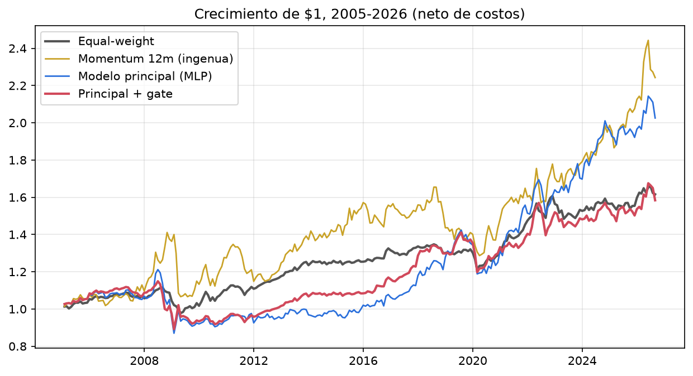

# ¿Puede la IA elegir qué factores de inversión ganarán?

**Autor:** Oscar Martinez · Proyecto de Inteligencia Artificial · 2026

Un **agente racional** que cada mes decide cómo repartir una inversión entre 6 *factores* (estilos de inversión como valor, momentum o rentabilidad). Una **red neuronal** estima qué factores tienen más probabilidad de ganar. Un segundo modelo, el **gate de confiabilidad** (*meta-labeling*), decide cuándo no confiar en ella. Todo se evalúa fuera de muestra, sin mirar al futuro y con reglas de éxito escritas antes de correr los experimentos.



---

## Cómo ejecutar la demo

Requisitos: **Python 3.11 o superior** y `git`.

**macOS / Linux**
```bash
git clone https://github.com/dongabooo/factor-timing-ia.git
cd factor-timing-ia
python3 -m venv .venv
source .venv/bin/activate
pip install -e .
streamlit run app/demo.py
```

**Windows (PowerShell)**
```powershell
git clone https://github.com/dongabooo/factor-timing-ia.git
cd factor-timing-ia
python -m venv .venv
.venv\Scripts\Activate.ps1
pip install -e .
streamlit run app/demo.py
```

Se abre el navegador en `http://localhost:8501`. La demo usa resultados ya calculados (incluidos en `data/interim/`), así que abre en segundos y no necesita internet.

### Las pestañas de la demo

| Pestaña | Qué muestra |
|---|---|
| 0 · Cómo funciona | El agente según Russell y Norvig (PEAS), el flujo de decisión y por qué se eligió cada técnica |
| 1 · Los datos | Crecimiento de los 6 factores en EE.UU. (desde 1963) y en desarrollados sin EE.UU. (desde 1990) |
| 2 · La decisión de hoy | Probabilidades que asigna la red a cada factor para el próximo mes y los 2 elegidos |
| 3 · Backtest | Valor de $1 por estrategia, con un **deslizador de costos de transacción** y métricas que se recalculan en vivo |
| 4 · El gate | Meses en que el gate se abstuvo y su calibración |
| 5 · Lo que aprendimos | Ventaja del modelo por periodo y la señal evaluada en un mercado nunca visto |

## Reproducir todo desde cero (opcional)

Los scripts descargan los datos de Ken French y FRED (internet requerido) y vuelven a entrenar todo. Tardan alrededor de 15 minutos en total.

```bash
python scripts_run_timing.py      # Experimento 1: red neuronal + gate (EE.UU.)
python scripts_run_timing_v2.py   # Experimento 2: freno de rotación
python scripts_run_timing_v3.py   # Experimento 3: trimestral + pesos + reducción en crisis; examen internacional
python scripts_build_demo_data.py # Datos de la demo (verifica con asserts que reproduce los reportes)
```

Nota: Ken French y FRED revisan sus series de vez en cuando. Una descarga futura puede mover las cifras en el tercer decimal.

---

## El problema

Cada mes, a unos factores les va mejor que a otros. Rotar hacia los ganadores (*factor timing*) es una idea atractiva, pero muy debatida en la literatura (Asness, 2016; Haddad, Kozak y Santosh, 2020). Este proyecto pregunta:

1. ¿Puede una red neuronal anticipar qué factores quedarán en la mitad ganadora el próximo mes?
2. ¿Puede un segundo modelo aprender **cuándo no confiar** en la primera?

## Relación con la IA: un agente racional

De los cuatro enfoques de Russell y Norvig, el proyecto sigue el de **actuar racionalmente**. No modela cómo piensa un inversionista humano (pensar como humano) ni intenta parecer uno (actuar como humano). Tampoco deduce con reglas lógicas (pensar racionalmente). **Percibe su entorno y elige la acción que maximiza su desempeño esperado bajo incertidumbre.** El gate es el agente evaluando su propia confianza.

| PEAS | En este proyecto |
|---|---|
| **P**erformance (medida de desempeño) | Retorno por unidad de riesgo (Sharpe), neto de costos |
| **E**ntorno | Mercado de factores: estocástico, no estacionario, parcialmente observable y con otros agentes (inversionistas) que explotan las mismas señales |
| **A**ctuadores | Pesos del portafolio entre los 6 factores |
| **S**ensores | Retornos pasados de los factores y datos macro **ya publicados** |

## Técnicas y por qué

| Técnica | Por qué |
|---|---|
| **Red neuronal** (perceptrón multicapa, scikit-learn) | Las señales interactúan de forma no lineal. Se comparó contra *gradient boosting* y se eligió la ganadora en validación 1996–1999, antes del periodo de evaluación |
| **Formulación de ranking** | Para decidir el portafolio importa si un factor le gana a los demás, no cuánto rinde |
| **Meta-labeling** (López de Prado, 2018) | Un segundo modelo aprende cuándo el primero se equivoca: la capa de confiabilidad |
| **Walk-forward con embargo** | Reentrenamiento anual solo con el pasado. Ninguna etiqueta del futuro entra al entrenamiento |
| **Bootstrap pareado por bloques** | Intervalos de confianza para diferencias de Sharpe que respetan la autocorrelación |

**Controles de rigor:**
- Un test automático de *no-fuga* recalcula las variables truncando los datos en cada mes. Un control negativo demuestra que el test sí detecta fugas.
- Los criterios de éxito de cada experimento se escribieron antes de correrlo (carpeta [`preregistro/`](preregistro/)).

## Resultados principales

| Experimento | Criterio fijado de antemano | Veredicto |
|---|---|---|
| 1 · Red neuronal + gate (EE.UU. 2005–2026) | El gate mejora el Sharpe y acierta > 50% al abstenerse | **No funciona**: Sharpe 0.36 contra 0.44; acierto 42.5%; AUC 0.43 |
| 2 · Freno de rotación | Sharpe > 0.440 | **No funciona**: la calibración eligió no frenar |
| 3 · Trimestral + pesos + reducción en crisis, examinado en **desarrollados sin EE.UU. (nunca vistos)** | Sharpe > modelo mensual | **Funciona formalmente** (1.43 contra 1.13), pero la calibración convirtió la estrategia en repartir parejo |

**Hallazgos:**
- **Los costos deciden.** Antes de costos, la red empata con repartir parejo (Sharpe 0.552 contra 0.550). Rota el 75% del portafolio cada mes, y con 10 pb de costo cae a 0.44.
- **El gate dudaba al revés.** Cuando menos confiaba, la red acertaba más.
- **La ventaja cambia con el tiempo.** Fue grande en 2000–2004, desapareció entre 2005 y 2014 y volvió después. Es consistente con el deterioro de anomalías tras su publicación (McLean y Pontiff, 2016): el entorno tiene otros agentes que aprenden.
- **La señal existe y se traslada.** En el mercado nunca visto, el modelo trimestral ordena bien los factores (correlación de rangos +0.17, 62% de acierto). El reto es convertir esa señal en mejor riesgo-retorno que la diversificación.

Detalle completo en [`reports/`](reports/).

## Estructura

```
app/demo.py                  Demo interactiva (Streamlit)
src/factorlab/timing/        Motor: datos, variables, modelos, backtest, v3
scripts_run_timing*.py       Experimentos 1, 2 y 3
scripts_build_demo_data.py   Precálculo de la demo
reports/                     Reportes de cada experimento (español)
preregistro/                 Planes con los criterios fijados antes de correr
notebooks/                   Figuras del experimento 1
data/interim/                Resultados ya calculados
```

## Datos y atribución

- **Factores:** [Kenneth R. French Data Library](https://mba.tuck.dartmouth.edu/pages/faculty/ken.french/data_library.html): Fama-French 5 factores + Momentum, EE.UU. y desarrollados sin EE.UU.
- **Macro:** [FRED](https://fred.stlouisfed.org/), Federal Reserve Bank of St. Louis: T10Y3M, BAA10Y, UNRATE, CPIAUCSL, VIXCLS.

## Limitaciones

- Los factores son portafolios académicos largo-corto, no investibles directamente. Los costos se modelan de forma lineal.
- FRED se usa en su versión actual, no la publicada en su momento (sin ALFRED).
- Los experimentos 2 y 3 son exploratorios: se diseñaron después de ver el primero. Por eso el examen del 3 se hizo en un mercado nunca usado.

## Referencias

- Russell, S. y Norvig, P. *Artificial Intelligence: A Modern Approach*.
- López de Prado, M. (2018). *Advances in Financial Machine Learning*. Wiley.
- McLean, R. D. y Pontiff, J. (2016). Does Academic Research Destroy Stock Return Predictability? *Journal of Finance*, 71(1).
- Asness, C. (2016). The Siren Song of Factor Timing. *Journal of Portfolio Management*.
- Haddad, V., Kozak, S. y Santosh, S. (2020). Factor Timing. *Review of Financial Studies*, 33(5).
- Daniel, K. y Moskowitz, T. (2016). Momentum Crashes. *Journal of Financial Economics*, 122(2).
